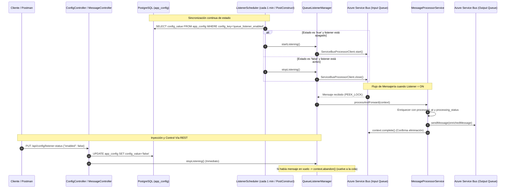

# Demo Colas Azure — Microservicio PoC con Azure Service Bus

Microservicio desarrollado en **Spring Boot 4.0.9** con **Java 21** para la gestión dinámica y reactiva del consumo de mensajes desde colas de **Azure Service Bus**, con control de estado persistido en **PostgreSQL**, reconciliación periódica vía **Cron**, y reenvío enriquecido hacia colas de salida.

---

## 📋 Tabla de Contenidos

- [Arquitectura y Flujo de Datos](#-arquitectura-y-flujo-de-datos)
- [Características Principales](#-características-principales)
- [Requisitos Previos](#-requisitos-previos)
- [Políticas de Acceso en Azure Service Bus (SAS)](#-políticas-de-acceso-en-azure-service-bus-sas)
- [Variables de Entorno](#-variables-de-entorno)
- [Instrucciones de Despliegue y Ejecución](#-instrucciones-de-despliegue-y-ejecución)
  - [1. Iniciar Base de Datos (Docker Compose)](#1-iniciar-base-de-datos-docker-compose)
  - [2. Configurar Variables de Entorno](#2-configurar-variables-de-entorno)
  - [3. Iniciar la Aplicación](#3-iniciar-la-aplicación)
- [Catálogo de Endpoints REST](#-catálogo-de-endpoints-rest)
- [Flujo de Pruebas de Punta a Punta](#-flujo-de-pruebas-de-punta-a-punta)
- [Monitoreo y Métricas](#-monitoreo-y-métricas)
- [Resolución de Problemas (Troubleshooting)](#-resolución-de-problemas-troubleshooting)

---

## 🏛 Arquitectura y Flujo de Datos

El sistema implementa una separación clara de responsabilidades entre el listener dinámico, el procesador de mensajes y el reconciliador de estado:



---

## ⚡ Características Principales

1. **Gestión Dinámica del Ciclo de Vida del Processor**:
   - `ServiceBusProcessorClient` no es un bean estático; se crea, inicia y destruye en demanda sin reiniciar el proceso.
   - Concurrencia controlada con `maxConcurrentCalls(1)`.
2. **Cero Pérdida de Datos (In-Flight Safety)**:
   - Recepción en modo `PEEK_LOCK`.
   - Si el listener se detiene mientras se procesa un mensaje o ante un error inesperado, se ejecuta `context.abandon()`, devolviéndolo a la cola para reintento.
3. **Reconciliación Dual (REST + Cron)**:
   - El cambio vía `PUT /api/config/listener-status` se aplica **inmediatamente** en memoria y se persiste en BD.
   - El cron (`@Scheduled(fixedRate = 60000)`) garantiza que cualquier cambio manual directo en PostgreSQL se replique como máximo en 1 minuto.
   - Arranque inmediato al iniciar la aplicación mediante `@PostConstruct`.
4. **Seguridad con Mínimo Privilegio (SAS Policies)**:
   - Conexiones diferenciadas con cadenas separadas para **Lectura (`Listen`)** y **Escritura (`Send`)**.
5. **Enriquecimiento de Mensajes**:
   - Todo mensaje reenviado a la cola de salida incorpora metadatos en application properties:
     - `processed_at`: Marca de tiempo ISO-8601 del procesamiento.
     - `processing_status`: Marcado como `FORWARDED`.

---

## 📦 Requisitos Previos

- **Java 21** (JDK 21 instalado y configurado en el `PATH`).
- **Docker** y **Docker Compose** (para levantar la base de datos PostgreSQL local).
- **Namespace de Azure Service Bus** con al menos dos colas creadas (Entrada y Salida).
- Herramienta de pruebas como **Postman** (se incluye colección lista) o **cURL**.

---

## 🔐 Políticas de Acceso en Azure Service Bus (SAS)

Para un aislamiento seguro de credenciales, configura las siguientes Shared Access Policies en Azure Portal:

| Cola / Namespace | Tipo de Permiso SAS | Variable de Entorno | Uso |
|---|---|---|---|
| **Cola de Entrada** | `Listen` | `AZURE_SERVICEBUS_INPUT_CONNECTION_STRING` | Usada por el listener de recepción |
| **Cola de Entrada** | `Send` | `AZURE_SERVICEBUS_INPUT_SENDER_CONNECTION_STRING` | Usada por el endpoint `POST /api/messages/send` |
| **Cola de Salida** | `Send` | `AZURE_SERVICEBUS_OUTPUT_CONNECTION_STRING` | Usada por el productor que reenvía a salida |

> **Nota:** Si en un entorno de pruebas o desarrollo usas una única clave de nivel Namespace con permisos `Manage, Send, Listen`, puedes asignar el mismo valor a las tres variables.

---

## ⚙️ Variables de Entorno

Puedes consultar la plantilla base en [.env.example](file:///.env.example):

| Variable | Requerida | Valor por Defecto | Descripción |
|---|:---:|---|---|
| `AZURE_SERVICEBUS_INPUT_CONNECTION_STRING` | **Sí** | — | Cadena de conexión con permiso `Listen` para la cola de entrada. |
| `AZURE_SERVICEBUS_INPUT_SENDER_CONNECTION_STRING` | No | Copia de input | Cadena de conexión con permiso `Send` para enviar mensajes de prueba a la entrada. |
| `AZURE_SERVICEBUS_INPUT_QUEUE_NAME` | No | `input-queue` | Nombre de la cola de entrada en Azure. |
| `AZURE_SERVICEBUS_OUTPUT_CONNECTION_STRING` | **Sí** | — | Cadena de conexión con permiso `Send` para la cola de salida. |
| `AZURE_SERVICEBUS_OUTPUT_QUEUE_NAME` | No | `output-queue` | Nombre de la cola de salida en Azure. |
| `AZURE_SERVICEBUS_RETRY_MAX_RETRIES` | No | `3` | Número máximo de reintentos a nivel de transporte AMQP. |
| `AZURE_SERVICEBUS_RETRY_DELAY` | No | `1s` | Retardo inicial entre reintentos AMQP (Backoff Exponencial). |
| `AZURE_SERVICEBUS_RETRY_MAX_DELAY` | No | `10s` | Retardo máximo entre reintentos AMQP. |
| `AZURE_SERVICEBUS_MAX_AUTO_LOCK_RENEW_DURATION` | No | `5m` | Tiempo máximo de auto-renovación de bloqueo (retención de mensaje). |
| `AZURE_SERVICEBUS_MAX_DELIVERY_COUNT` | No | `5` | Límite de intentos de entrega antes de enviar a Dead-Letter Queue (DLQ). |
| `SPRING_DATASOURCE_URL` | No | `jdbc:postgresql://localhost:5432/demo_colas` | URL JDBC de conexión a PostgreSQL. |
| `SPRING_DATASOURCE_USERNAME` | No | `postgres` | Usuario de base de datos. |
| `SPRING_DATASOURCE_PASSWORD` | No | `postgres` | Contraseña de base de datos. |

---

## 🚀 Instrucciones de Despliegue y Ejecución

### 1. Iniciar Base de Datos (Docker Compose)

En la raíz del proyecto, ejecuta:

```bash
docker compose up -d
```

Verifica que el contenedor esté saludable:
```bash
docker compose ps
```
> El contenedor ejecuta PostgreSQL 16 expuesto en el puerto `5432` y crea la base de datos `demo_colas`. La tabla `app_config` y el registro inicial (`queue_listener_enabled = true`) son creados automáticamente por Spring Boot al arrancar mediante `src/main/resources/schema.sql` y `data.sql`.

---

### 2. Configurar Variables de Entorno

#### En Windows (PowerShell):
```powershell
$env:AZURE_SERVICEBUS_INPUT_CONNECTION_STRING="Endpoint=sb://<tu-ns>.servicebus.windows.net/;SharedAccessKeyName=ListenKey;SharedAccessKey=..."
$env:AZURE_SERVICEBUS_INPUT_SENDER_CONNECTION_STRING="Endpoint=sb://<tu-ns>.servicebus.windows.net/;SharedAccessKeyName=SendKey;SharedAccessKey=..."
$env:AZURE_SERVICEBUS_INPUT_QUEUE_NAME="input-queue"

$env:AZURE_SERVICEBUS_OUTPUT_CONNECTION_STRING="Endpoint=sb://<tu-ns>.servicebus.windows.net/;SharedAccessKeyName=SendKey;SharedAccessKey=..."
$env:AZURE_SERVICEBUS_OUTPUT_QUEUE_NAME="output-queue"
```

#### En Linux / macOS (Bash):
```bash
export AZURE_SERVICEBUS_INPUT_CONNECTION_STRING="Endpoint=sb://<tu-ns>.servicebus.windows.net/;SharedAccessKeyName=ListenKey;SharedAccessKey=..."
export AZURE_SERVICEBUS_INPUT_SENDER_CONNECTION_STRING="Endpoint=sb://<tu-ns>.servicebus.windows.net/;SharedAccessKeyName=SendKey;SharedAccessKey=..."
export AZURE_SERVICEBUS_INPUT_QUEUE_NAME="input-queue"

export AZURE_SERVICEBUS_OUTPUT_CONNECTION_STRING="Endpoint=sb://<tu-ns>.servicebus.windows.net/;SharedAccessKeyName=SendKey;SharedAccessKey=..."
export AZURE_SERVICEBUS_OUTPUT_QUEUE_NAME="output-queue"
```

---

### 3. Iniciar la Aplicación

#### En Windows:
```powershell
.\mvnw.cmd spring-boot:run
```

#### En Linux / macOS:
```bash
./mvnw spring-boot:run
```

---

## 📡 Catálogo de Endpoints REST

La API se expone en `http://localhost:8080`. Se incluye la colección de Postman en [Demo-Colas-Azure.postman_collection.json](file:///Demo-Colas-Azure.postman_collection.json).

### 1. Consultar Estado y Métricas del Listener
- **Método**: `GET`
- **URL**: `/api/config/listener-status`
- **Respuesta 200 OK**:
  ```json
  {
    "enabled": true,
    "running": true,
    "metrics": {
      "messagesProcessed": 12,
      "messagesAbandoned": 1,
      "messagesErrored": 0,
      "lastMessageProcessedAt": "2026-10-27T19:40:00Z"
    }
  }
  ```

---

### 2. Modificar Estado del Listener (Encender / Apagar)
- **Método**: `PUT`
- **URL**: `/api/config/listener-status`
- **Headers**: `Content-Type: application/json`
- **Payload para Apagar**:
  ```json
  {
    "enabled": false
  }
  ```
- **Respuesta 200 OK**:
  ```json
  {
    "enabled": false,
    "running": false,
    "message": "Listener apagado inmediatamente y guardado en BD. Mensajes in-flight abandonados para reintento."
  }
  ```
- **Payload para Encender**:
  ```json
  {
    "enabled": true
  }
  ```

---

### 3. Enviar Mensaje de Prueba a la Cola de Entrada
- **Método**: `POST`
- **URL**: `/api/messages/send`
- **Headers**: `Content-Type: application/json`
- **Payload**:
  ```json
  {
    "message": "{\"orderId\": \"ORD-1001\", \"amount\": 250.00, \"customer\": \"Empresa XYZ\"}",
    "properties": {
      "correlationId": "ABC-123",
      "tipoEvento": "CREACION_ORDEN"
    }
  }
  ```
- **Respuesta 200 OK**:
  ```json
  {
    "status": "SENT_TO_INPUT_QUEUE",
    "messageId": "73e93a0b-1632-4299-b13c-38708bbd7f26",
    "content": "{\"orderId\": \"ORD-1001\", \"amount\": 250.00, \"customer\": \"Empresa XYZ\"}",
    "properties": {
      "correlationId": "ABC-123",
      "tipoEvento": "CREACION_ORDEN"
    }
  }
  ```

---

## 🧪 Flujo de Pruebas de Punta a Punta

Puedes validar todos los requerimientos funcionales siguiendo este orden:

1. **Verificar que el listener inicie activo**:
   ```bash
   curl -X GET http://localhost:8080/api/config/listener-status
   ```
   > Observa `"enabled": true` y `"running": true`.

2. **Enviar mensaje de prueba**:
   ```bash
   curl -X POST http://localhost:8080/api/messages/send \
     -H "Content-Type: application/json" \
     -d '{"message": "Test Message 1"}'
   ```
   > Revisa la consola del microservicio: verás los logs `Procesando mensaje`, `Mensaje enviado a cola de salida exitosamente` y `Mensaje completado en cola de entrada`.

3. **Apagar el listener**:
   ```bash
   curl -X PUT http://localhost:8080/api/config/listener-status \
     -H "Content-Type: application/json" \
     -d '{"enabled": false}'
   ```
   > Verás en el log `Listener detenido exitosamente`.

4. **Enviar mensaje con listener apagado**:
   ```bash
   curl -X POST http://localhost:8080/api/messages/send \
     -H "Content-Type: application/json" \
     -d '{"message": "Test Message 2 (En espera)"}'
   ```
   > El mensaje entrará en la cola de Azure, pero **el microservicio no lo procesará ni consumirá**. Permanecerá encolado en Azure Service Bus.

5. **Reactivar el listener**:
   ```bash
   curl -X PUT http://localhost:8080/api/config/listener-status \
     -H "Content-Type: application/json" \
     -d '{"enabled": true}'
   ```
   > De inmediato el listener se iniciará, tomará `Test Message 2`, lo enriquecerá y lo reenviará a la cola de salida.

---

## 📊 Monitoreo y Métricas

El proyecto tiene integrado **Spring Boot Actuator**:

- **Health Check General**:
  ```bash
  curl -s http://localhost:8080/actuator/health
  ```
  Devuelve el estado de PostgreSQL, Azure Service Bus y componentes.
- **Kubernetes Liveness Probe**:
  ```bash
  curl -s http://localhost:8080/actuator/health/liveness
  ```
- **Kubernetes Readiness Probe**:
  ```bash
  curl -s http://localhost:8080/actuator/health/readiness
  ```
- **Métricas del Sistema**:
  ```bash
  curl -s http://localhost:8080/actuator/metrics
  ```

---

## 🛡️ Blindaje contra Pods Zombies en Kubernetes

Un **Pod Zombie** en Kubernetes ocurre cuando:
1. El contenedor aparece en estado `Running`, pero sus hilos internos están bloqueados o su conexión de red murió silenciosamente sin consumir mensajes (**Zombie no reactivo**).
2. El Pod entra en estado `Terminating` al recibir `SIGTERM`, pero sus hilos o conexiones bloqueantes impiden que el proceso Java termine, requiriendo un `SIGKILL` forzado o quedando en estado huérfano (**Zombie atascado en terminación**).

### Protecciones Implementadas en el Código:

1. **Graceful Shutdown Controlado**:
   - `server.shutdown=graceful`: Termina las peticiones REST en vuelo ordenadamente.
   - `spring.lifecycle.timeout-per-shutdown-phase=20s`: Garantiza que Spring Boot complete su ciclo de apagado dentro del margen de seguridad de Kubernetes (`terminationGracePeriodSeconds` de 30s).
2. **Cierre Bounded con Timeout Asíncrono (10s)**:
   - Tanto `QueueListenerManager` como `ServiceBusConfig` implementan cierre acotado con `CompletableFuture.orTimeout(10, TimeUnit.SECONDS)`. Si Azure Service Bus o la red quedan congelados, el cierre no bloquea el hilo de shutdown de la JVM.
3. **Liveness & Readiness Probes Nativos**:
   - **Readiness Probe (`/actuator/health/readiness`)**: Es el probe que **más frecuentemente se comprueba en Kubernetes** (típicamente cada 5 a 10s). Incluye `readinessState`, `db` (PostgreSQL) y `serviceBus` (`ServiceBusHealthIndicator`). Si Service Bus presenta una falla fatal o la BD cae, el Pod se retira del balanceo de tráfico sin reiniciarlo en bucle.
   - **Liveness Probe (`/actuator/health/liveness`)**: Supervisa el ciclo de vida de la JVM y deadlocks de hilos del contenedor. Si la JVM colapsa, Kubelet reinicia el Pod.
   - `AvailabilityListener`: Emite alertas en el log ante cualquier cambio de estado en los probes.

### Configuración Recomendada en el Deployment de Kubernetes:

```yaml
spec:
  terminationGracePeriodSeconds: 30
  containers:
    - name: demo-colas-azure
      image: demo-colas-azure:latest
      ports:
        - containerPort: 8080
      livenessProbe:
        httpGet:
          path: /actuator/health/liveness
          port: 8080
        initialDelaySeconds: 30
        periodSeconds: 15
        failureThreshold: 3
      readinessProbe:
        httpGet:
          path: /actuator/health/readiness
          port: 8080
        initialDelaySeconds: 15
        periodSeconds: 10
        failureThreshold: 2
```

---

## 🛠 Resolución de Problemas (Troubleshooting)

### 1. `Connection refused: localhost:5432`
- **Causa**: El contenedor de PostgreSQL no está levantado.
- **Solución**: Ejecuta `docker compose up -d` y verifica con `docker compose ps` que el puerto `5432` esté escuchando.

### 2. `UnauthorizedException` o `401: Invalid SAS token or signature` en Service Bus
- **Causa**: Cadena de conexión incorrecta o expirada.
- **Solución**: Verifica que la cadena empiece con `Endpoint=sb://...` y contenga un `SharedAccessKey` válido. Asegúrate de que para el listener tenga permiso `Listen` y para los senders tenga permiso `Send`.

### 3. Mensaje no se procesa al reactivar
- **Causa**: Si el listener fue apagado vía Base de Datos directamente (vía script SQL), el cron tardará hasta 60 segundos en detectarlo.
- **Solución**: Puedes esperar el ciclo del cron o utilizar el endpoint `PUT /api/config/listener-status` para activación inmediata.
